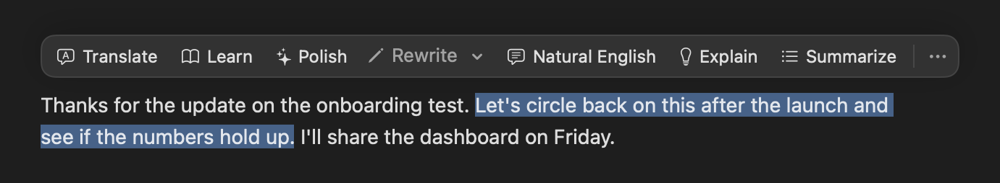
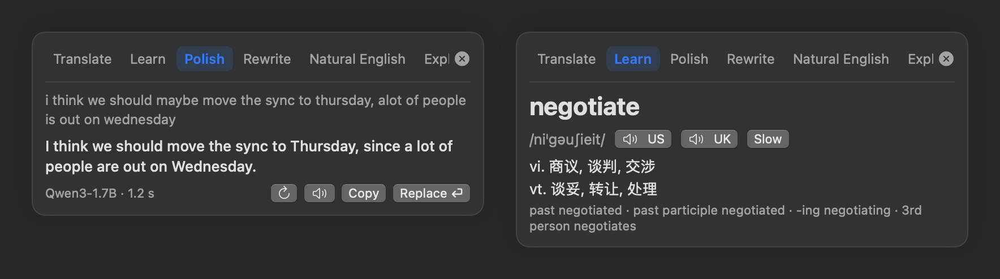
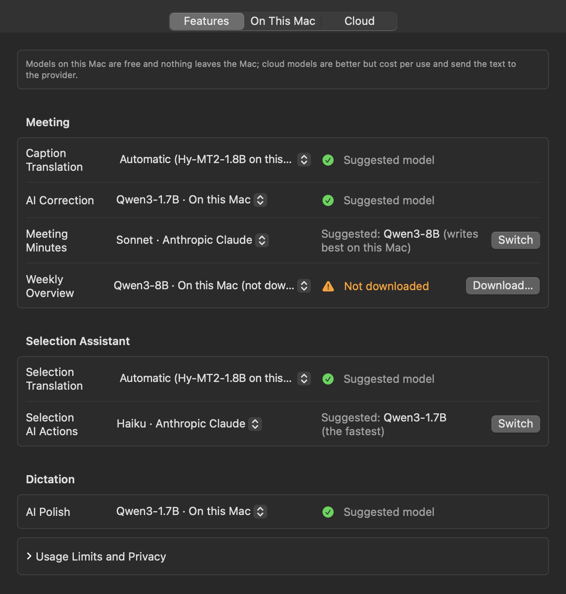

# Baobox

[](https://github.com/qiaob/baobox_mac/actions/workflows/build-macos.yml)
[](https://github.com/qiaob/baobox_mac/actions/workflows/build-windows.yml)
[](https://github.com/qiaob/baobox_mac/actions/workflows/build-linux.yml)

**A menu-bar toolbox for macOS** — screenshots, clipboard, window management, menu-bar
tidying, keyboard clicking, sleep prevention, meeting notes and live subtitles, voice dictation,
a selection assistant, phone transfer, a desktop pet, focus and health reminders, plus dashboards
for the Claude Code and Codex CLIs. One app instead of five, with one shortcut system and one
settings window; every AI feature can use a model on your Mac or a cloud model of your choice.

[简体中文](README.zh-CN.md) · [User manual](docs/manual/en/README.md) · [Shortcuts](docs/manual/en/shortcuts.md)

```
macOS 14+   ·   Swift 5.9   ·   Zero third-party Swift dependencies   ·   Local by default
```

## Contents

- [What it is](#what-it-is)
- [The tools](#the-tools)
- [Install](#install)
- [First launch](#first-launch)
- [Shortcuts](#shortcuts)
- [Data and privacy](#data-and-privacy)
- [Build from source](#build-from-source)
- [Project layout](#project-layout)
- [Adding a tool](#adding-a-tool)
- [Documentation](#documentation)

## What it is

The small utilities you use every day normally mean four or five separate apps — one for
screenshots, one for clipboard history, one for window management — each sitting in the
background with its own settings and its own shortcuts. Baobox makes them **modules inside
one native app**:

- **Native, not Electron** — Swift 5.9 with SwiftUI and AppKit, **zero third-party Swift
  dependencies** (local models run in a bundled llama.cpp process)
- **Modular** — the app shell knows nothing about any specific tool; each module implements
  the `ToolModule` protocol and registers its own menu, shortcuts, and settings page
- **Local by default** — nothing is collected and there is no account. Cloud AI models are off
  by default; text goes to a provider only when you pick a cloud model for a feature and use it

No Dock icon (`LSUIElement`); everything lives in the menu bar.

## The tools

| Tool | Default shortcut | In one line |
|---|---|---|
| [Screenshot & recording](docs/manual/en/screenshot.md) | ⌘⇧2 · ⌃⇧R | Smart capture, annotation, pinning, scrolling capture, on-screen OCR, recording, history |
| [Draw on Screen](docs/manual/en/screenshot.md#live-drawing) | unbound | Draw straight onto the screen; in pass-through mode the strokes stay while you keep working underneath |
| [Clipboard](docs/manual/en/clipboard.md) | ⌘⇧V · ⌘⌥V | History, search, paste-back, favorites, format detection and conversion, text snippets, encrypted at rest |
| [Window manager](docs/manual/en/window-manager.md) | ⌃⌥ family | Halves, quarters, maximize, center, across displays — 13 actions plus layout snapshots |
| [Menu Bar](docs/manual/en/menubar.md) | unbound | Show or hide each menu-bar icon; hidden icons, and ones covered by the notch, open from the top of the Baobox menu |
| [Keyboard clicking](docs/manual/en/keyboard-nav.md) | ⌘⇧Space | Two-letter labels on every clickable element; also keyboard scrolling |
| [Meeting](docs/meeting/REQUIREMENTS.md) | unbound | Next-meeting countdown, one-click join, auto-detects meetings, local transcript, minutes and action items |
| [Subtitles & Interpreting](docs/manual/en/live-translate.md) | unbound | Live captions and translation from the mic or system audio (21 languages), AI correction, spoken translation into a call; now part of Meeting |
| [Selection assistant](docs/selection-translate/ASSISTANT.md) | unbound | Select text in any app → action bar: Translate, Learn, Polish, Rewrite, Natural English, Explain, Summarize |
| [Voice dictation](docs/dictation/REQUIREMENTS.md) | ⌥Space (start / stop) | Hold-to-talk, continuous (sentence by sentence) or long dictation; the text lands at your cursor in any app, optional AI polish, with history |
| [Focus & health](docs/focus-health/REQUIREMENTS.md) | unbound | Focus timer, water / stand / 20-20-20 reminders, break screen delivered by the desktop pet |
| [Desktop pet](docs/desktop-pet/DESIGN.md) | unbound | A pet on your desktop that is also Baobox's unified notification center |
| [Keep awake](docs/manual/en/caffeinate.md) | menu only | Timed sleep prevention, optional display-on |
| [Phone Transfer](docs/manual/en/phone-transfer.md) | unbound | Scan a QR code, send files and text between Mac and phone — LAN, or direct P2P over the internet; no phone app |
| [Claude Code assistant](docs/manual/en/claude-code.md) | ⌃⇧Space | Session resume, quota and usage, audit, notifications, visual config, statusline, MCP |
| [Codex assistant](docs/manual/en/codex.md) | unbound | Session resume, quota and usage, visual config, turn notifications, maintenance |

### The framework itself

- Menu-bar resident, no Dock icon; the menu is a plain list of tools, one row each,
  hover to open its submenu
- Global hotkey center (Carbon): registration, **conflict detection**, customization,
  persistence, reset to default
- One settings window: General / Shortcuts / AI / one page per tool / About
- Every feature that uses a model picks it in Settings → AI (on this Mac or in the cloud) — see [AI models](#ai-models)
- First-launch permission onboarding with live status
- Optional launch at login (`SMAppService`)
- English and Simplified Chinese, or follow the system

### Screenshot & recording

One shortcut figures out what you meant: **hover to highlight a window, click to capture
it**; **press and drag** (past a ~4 pt threshold) to switch to a region; **⏎** for the whole
screen; **Esc** to cancel.

- Eight-way handles, **arrow keys nudge by one pixel** (⇧ for ×10), and a pixel loupe that
  shows live coordinates and the color under the cursor
- Multi-display, with an independent overlay per screen
- **Menus can be captured too**: if a context menu or menu-bar dropdown is open when you
  press the shortcut, the whole screen is frozen before Baobox activates and the menu
  closes — so the menu is still there in the shot
- **Annotation**: rectangle, ellipse, arrow, pen, highlighter, mosaic, text, eraser
  (removes a whole stroke). Undo ⌘Z, redo ⇧⌘Z, copy and finish ⏎, save ⌥⏎
- **Pinning**: keep an image floating above every window — resize it, change its opacity,
  run OCR on it, save it. You can also pin whatever image is on the clipboard
- **Scrolling capture**: frame a scrollable area, scroll the page yourself, and adjacent
  frames are aligned by their overlap into one tall image; the preview offers save, copy,
  pin, and OCR
- **On-screen OCR**: recognized **locally** by the system Vision framework (nothing is
  uploaded), with selectable language sets. **The result is editable before you copy it**,
  and QR codes or barcodes in the frame are decoded alongside the text
- **Recording**: the same selection flow, output as MP4 or GIF; system audio and microphone
  (a separate second track, optionally mixed down to one); pause, resume, or discard mid-recording
- **History**: the last 20 shots by default — copy, pin, save, or delete any of them

**Draw on Screen** has its own entry in the menu and shares the annotation tools: draw straight onto
the live screen, and in **pass-through mode** the strokes stay put while you keep using the app underneath.

### Clipboard

Text, images, files, and links are all recorded. **⌘⇧V** opens the panel with the cursor
already in the search field; **⏎ pastes straight back** into the app you came from.

- Type filters (all / text / link / image / file / favorites), favorites pinned to the top,
  plain-text paste (⌘⌥V)
- **Text tools in the preview pane**: JSON, JWT, XML, timestamps, URLs, Base64, and curl
  commands are detected automatically, with in-place actions — format, decode, extract,
  MD5/SHA, **generate a QR code** — and a one-click revert
- **Large editor**: monospaced, undo, ⌘F find
- **Text snippets**: save text you type often, give it a keyword, and typing
  "prefix + keyword" in any input field expands it in place
- **Privacy**: content marked by password managers is skipped by default; transient content
  is always ignored; you can ignore specific apps; auto-cleanup after 1/7/30/90 days
- **Encryption**: history is written to disk with **AES-GCM** by default. The key is a
  random 256-bit value in the login keychain — it never leaves the Mac and never syncs to iCloud

### Window manager

All 13 actions are bindable and ship bound to the **⌃⌥** family.

> ⚠️ The ⌃⌥ set collides exactly with Rectangle and Magnet. If you run one of those,
> rebind one side in Settings.

- Full multi-display support: the target screen is the one with the **largest intersection**;
  layout is based on each screen's **visible frame** (menu bar and Dock excluded);
  moving across displays maps position and size proportionally and clips to bounds, so
  nothing deforms or overflows between different resolutions
- **Layout snapshots**: save where every window is and restore it later. Matching is by
  title first, order as fallback; apps that aren't running are skipped. Each entry records a
  stable per-display UUID and the window's relative position on that display, so a
  resolution or arrangement change doesn't break it
- Configurable gap between windows (0 = flush)

### Keyboard clicking

Press **⌘⇧Space** and every clickable element gets a two-letter label; type the letters to
click it. Elements come from the accessibility tree, so these are **real controls**, and
clicks prefer `AXPress` — **your actual mouse never moves**.

- **Continuous mode**: labels refresh after each click so you can keep going; Esc or a real
  mouse click exits
- **Label scope**: current display only, or all of them
- **Keyboard scrolling**: j/k to scroll, Space to page — for pages like Chrome that don't
  expose a scrollbar element

### Subtitles & Interpreting

Pick the **microphone** or **system audio** as the source; speech becomes live captions with a
translation, shown in a draggable translucent bar at the bottom of the screen (bilingual /
translation only / original only). 21 languages; the spoken language can be set to "Automatic",
which decides between two languages sentence by sentence. Recognition uses the system Speech
framework (on-device when available). Translation uses the built-in on-device Apple Translation
(macOS 15+) by default, the offline model Hy-MT2-1.8B on macOS 14 or for languages Apple doesn't
cover, or a cloud model you pick in Settings → AI.

- **AI correction**: the local Qwen3-1.7B fixes misrecognized Chinese words sentence by sentence
  (or another model of your choice)
- **Interpreting**: the translation is read aloud and can go into Zoom, Meet, and other calls as
  your microphone through Baobox's own virtual microphone ("Baobox 同传", installed only when
  you click Install in Settings), or just play in your headphones
- Sessions can be saved as **transcripts**

It is now part of Meeting (it used to be called Live Translate): online, in-person, and
free-listening sessions all run on this engine and caption bar, with transcripts filed in the
meeting library.

### Selection assistant

Select text in **any app** and a small action bar appears above it: **Translate · Learn · Polish ·
Rewrite · Natural English · Explain · Summarize**, plus your own actions (a name and a prompt).
Nothing runs until you click; rewrites can **replace the original text** in editable fields.





Hold ⌥ to pick by number, use the Show Action Bar hotkey and a letter for keyboard-only use, or bind
a direct hotkey per action. **Learn** follows your native / learning language (Chinese and English
for now): a dictionary card (phonetics, US/UK pronunciation, meanings, word forms, from the offline
ECDICT dictionary) or a sentence view (tap words, word-by-word highlight while reading, repeat-after
scoring). AI actions use the model picked in Settings → AI (the local Qwen3-1.7B out of the box). Text is grabbed
via the accessibility tree, a clipboard fallback, or region OCR; translation shares Live Translate's engines.

### Meeting

One tool, three kinds of session — **online meeting, in-person meeting, free listening**
(the old Live Translate scenario). The menu shows the **next meeting with a countdown**,
and **one-click join** opens its link (Zoom, Tencent Meeting, DingTalk, Google Meet, Teams,
Feishu, Webex) straight from the calendar event. Baobox reads your local calendars via
EventKit (read-only, nothing leaves the Mac) and can also **detect a meeting on its own** —
a calendar event starting, or a meeting app holding the microphone — and offers to record it.

- **Before**: pre-meeting brief (last session's summary plus unfinished action items),
  reminder shortly before start, device check that records 3 seconds of mic + system audio
- **During**: a small floating control bar (● REC + elapsed time + mic/system-audio levels,
  mute either channel, pause, mark a highlight, jot a quick note that lands in the minutes).
  The menu bar shows a recording indicator; focus and health reminders are deferred while
  you record
- **After**: local transcript → minutes (summary, decisions, action items with owners and due
  dates, highlighted passages; a local model by default, or a cloud model picked in
  Settings → AI), kept in a searchable **meeting library** with a cross-meeting action-item view,
  per-series timeline, and weekly report. If no model is usable (local not downloaded, cloud
  unreachable), the transcript is still saved and marked "transcript only"

Meetings, free listening, and dictation share one microphone, so only one of them records
at a time.

### Voice dictation

Speak anywhere and the words land **at the cursor in whatever app you're in** — no
switching windows, no pasting. Three modes: **hold to talk** (press and hold, release to
insert), **continuous** (press once to start; each sentence is typed in as soon as you pause,
so you can keep going; press again or stay quiet for 30 seconds to stop), and
**long dictation** (keeps going until you stop; results collect in a panel you can edit
before inserting). Recognition prefers on-device, auto-detects Chinese vs English (sentence
by sentence in continuous mode), and shares Live Translate's glossary.

- **Text cleanup before it lands**: voice commands ("new line", "句号", "delete last
  sentence"), filler-word filtering, punctuation tidied for the language
- **Insertion degrades gracefully**: direct write into the text field (Accessibility) →
  simulated paste via a clipboard snapshot that never enters clipboard history → copy to
  clipboard with a prompt, if there's nowhere to type (e.g. a password field). Text is
  never lost: the recording bar offers one-click copy, and everything is in dictation history
- **AI polish** (optional, per app): turns speech into written text with a local or cloud
  model; it waits at most 8 seconds, then inserts the original
- **History**: recent dictations (text only, never audio) — search, copy, re-insert, delete

### Desktop pet

A cat, dog, bunny — or a 2D anime character — that lives on your desktop, walks around,
sleeps when you're away, and **is Baobox's notification center**: instead of every module
firing its own system notifications, they all come through the pet as bubbles, with buttons
you can act on. Clicking a Claude Code / Codex notification jumps straight to its terminal.

- **Looks**: 3 built-in plush 3D pets, more downloadable from Settings, plus VRM anime
  figures with procedural motions — the pet roams the bottom of the screen and can perch
  on window edges. Sprite packs (frame sequences + `pet.json`) work too
- **Notifications**: three levels (ambient / bubble / alert), do-not-disturb, de-duplication
  and batching. Meeting reminders, focus and health nudges, AI task completions, and
  minutes-ready all arrive here; with the pet off, they fall back to system notifications
- **Planned, not in this release: open to other apps on this Mac**. Local processes would send
  notifications through a Unix socket (`~/Library/Application Support/Baobox/pet.sock`, JSON,
  one line per message), a small `baobox-pet` CLI wrapper, or a `baobox://notify` URL.
  Same-user only, no network port, first-time sources need your approval, and Baobox never runs
  commands for another process: a button click only reports the choice back (#113)
- **Radial menu**: click the pet for the Baobox menu; right-click for the pet menu
  (switch pet, size, quiet for a while, notification history, settings). The radial menu
  also holds shortcuts to the other tools

### Focus & health

Focus timing and health reminders are **one tool**: focus runs the work block, reminders
and breaks run the gaps between them.

- **Focus timer**: 25 / 50 / 90 minute presets, do-not-disturb while focusing, and when
  time's up the pet announces it and flows straight into the break — rounds loop
- **Reminders**: water (45 min), stand up (60 min), eyes 20-20-20 (20 min), long break
  (50 min) out of the box; add your own, by interval or by fixed time of day
- **Breaks**: gentle (a pet bubble) or strong — the pet walks to the center of the screen,
  grows big, and keeps you company through the countdown, dimming and blurring the
  background on the strict setting. On the standard and strict settings a break ends with a
  Touch ID check that it's really you (can be turned off). If the pet is off, a full-screen
  break card is the fallback
- **Smart about context**: reminders wait out meetings, full-screen apps, and recordings;
  time away from the computer counts as a natural break, so you don't get nagged for a
  break you already took; the menu bar shows the countdown

### Keep awake

Built on IOKit power assertions. Pick 15 minutes, 1 hour, 2 hours, or indefinite from the
menu; it releases itself when the timer runs out and the menu shows the remaining time.
Optionally keeps the display on too. The assertion is always released on quit.

### Claude Code / Codex assistants

Both bring a local AI coding CLI into the menu bar. **Everything is parsed from local
files — no AI API calls, no login.**

- **Resume sessions**: the most recent ones are one click away in your terminal, plus a
  Spotlight-style search panel (in Claude Code, Tab switches to a "recent files" mode that
  opens the files it last wrote)
- **Usage and quota**: 5-hour and weekly windows, today's spend, reports by day / project /
  model, and call statistics
- **Audit** (Claude Code): files changed per day, revealable in Finder
- **Notifications**: when a task finishes or Claude is waiting for you, with sound or
  **spoken** alerts; warnings at 80% of a token budget and when a quota window resets
- **Dangerous-command guard** (Claude Code): `rm -rf /`, `sudo rm`, `git push --force`,
  `git reset --hard`, `DROP TABLE`, `mkfs`, `chmod -R 777` and friends are blocked before
  they run, with the reason handed back to Claude. Custom regex rules are supported
- **Visual configuration**: permission mode, default model, session retention, permission
  rules and presets, privacy switches, CLAUDE.md management (Claude Code); approval policy,
  sandbox mode, default model (Codex)
- **Statusline builder** (Claude Code): tick the segments, preview live, apply in one click,
  with a confirmation before overwriting an existing one
- **MCP**: add and remove user-level servers for Claude Code; read-only listing for Codex
- **Maintenance**: disk usage, cleanup of old sessions, version check and a copyable
  upgrade command

> All costs are **estimates** based on public pricing, and labeled as such throughout.
>
> **Edits to your files are conservative**: only our own keys are touched, unknown fields
> and comments are preserved, and a `.baobox.bak` backup is written first. When a value
> can't be edited safely the control is disabled rather than risk corrupting the file.

### AI models

Every feature that uses a model — selection translation and AI actions, caption translation,
AI correction, meeting minutes, the weekly overview, dictation polish — picks its own model in
Settings → AI, configured in one place like shortcuts. Each tool's settings page shows the same row.



- **Features**: one line per feature — the model it uses; a problem comes with a fix button
  ("Download…", "Set Up…"); otherwise the line says which model is suggested for that feature
  (the fastest for live work, the largest your Mac runs comfortably for minutes), with a
  one-click Switch
- **On This Mac**: free, and nothing leaves the Mac. A dozen common models (Qwen3, Gemma 3,
  Llama 3.1, GLM-4, Phi-4-mini, DeepSeek-R1 distills) plus any GGUF file from a Hugging Face
  link; grouped by this Mac's memory ("runs well" / "uses a lot of memory" / "not enough
  memory"), with download, start / stop, and launch at login
- **Cloud**: connect several providers (Claude, OpenAI, Gemini, DeepSeek, Qwen, Kimi, GLM,
  OpenRouter, SiliconFlow, Groq, Ollama, or any OpenAI-compatible endpoint), one key per
  provider with several named models; keys live in the Keychain. Cloud errors fall back to the
  local model when it's downloaded, and all cloud models share a per-reply and per-minute cap

## Install

### Download a release

Grab the latest `.zip` from [Releases](https://github.com/qiaob/baobox_mac/releases),
unzip it, and drag `Baobox.app` into Applications. If Gatekeeper blocks the first launch,
allow it under System Settings → Privacy & Security.

### Requirements

- macOS 14 (Sonoma) or later
- Apple silicon and Intel both supported

## First launch

Onboarding asks for two permissions:

| Permission | Used for | Without it |
|---|---|---|
| **Screen Recording** | Screenshots, recording, OCR, live drawing | Those features don't work |
| **Accessibility** | Clipboard paste-back, window management, keyboard clicking, keyword expansion | Clipboard degrades to copy-only; window management and keyboard clicking are unavailable |

> ⚠️ A system quirk: after you tick Screen Recording in System Settings you **must restart
> Baobox** for it to take effect. Both the onboarding window and the settings page offer a
> one-click restart.

Skipping is fine — you can grant them later under Settings → General → Permissions.
Microphone and speech recognition are only requested when you use them: recording, subtitles
and interpreting, meeting notes, or dictation. Calendar access is only requested when you turn
on the calendar in Meeting's settings.

## Shortcuts

Bound out of the box:

| Shortcut | Action |
|---|---|
| ⌘⇧2 | Smart screenshot |
| ⌃⇧R | Start / stop recording |
| ⌘⇧V | Clipboard history panel |
| ⌘⌥V | Paste last item as plain text |
| ⌘⇧Space | Keyboard clicking |
| ⌃⇧Space | Claude Code quick resume |
| ⌥Space | Start / stop dictation (continuous) |
| ⌃⌥ ← → ↑ ↓ / U I J K / ⏎ / C / ⌫ | The 13 window actions |
| ⌃⌥⌘ ← → | Move window across displays |

Everything else — OCR, drawing on screen, QR code, keyboard scrolling, each tool's panels and
toggles, the selection assistant's actions, dictation's hold-to-talk and long dictation, and so
on — ships **unbound** so it can't clash with other apps. Assign them under Settings → Shortcuts.
Full list in [Shortcuts](docs/manual/en/shortcuts.md).

## Data and privacy

**Everything stays on this Mac by default. Nothing is collected and there is no account.** Cloud
AI models are off by default; text goes to a provider only when you pick a cloud model for a
feature in Settings → AI and use that feature.

```
~/Library/Application Support/Baobox/<module>/   # one subdirectory per module
~/Pictures/Baobox/                               # default location for screenshots and recordings
```

- Clipboard history is **AES-GCM encrypted by default**; the key lives in the login
  keychain and never syncs to iCloud
- Content marked by password managers is not recorded by default; transient content is
  always ignored
- The Claude Code and Codex assistants **store nothing** — they read `~/.claude` and
  `~/.codex` live
- Meeting recordings, transcripts, and minutes stay on this Mac; dictation history stores
  text only, never audio
- Cloud AI keys live in the Keychain; Settings → AI → Usage Limits and Privacy lists what is
  currently sent to which provider
- Any other network access happens only when you ask for it: the version check (an npm lookup),
  downloading local models (Hugging Face / ModelScope), the ECDICT dictionary for Learn, or pets
  (GitHub / jsDelivr), and Phone Transfer (direct on the LAN; in internet mode, encrypted
  connection details pass through public signaling servers and the transfer itself is peer-to-peer)

See [Data and privacy](docs/manual/en/privacy-and-data.md).


## Repository layout

Three platform implementations live side by side:

```
mac/       macOS (Swift + SwiftUI/AppKit) — every tool
windows/   Windows (Rust + Win32/GDI) — tray app: screenshot, clipboard, caffeinate,
           window manager, both AI assistants, keyboard clicking
linux/     Linux (Rust + X11) — tray app: same six tools as Windows
shared/    Rust core shared by all three (geometry, selection, annotation, stitching, filenames)
```

Windows and Linux run in the system tray. Windows also offers a Desktop Pet menu
to show the pet and download characters. Put custom packs in `%APPDATA%\Baobox\Pets`
and select them in Settings. Meeting, subtitles and interpreting, the selection assistant,
dictation, focus & health, Menu Bar, Phone Transfer, and AI models are macOS-only for now. See
[multi-platform architecture](docs/multiplatform/ARCHITECTURE.md) (Chinese).

## Build from source

The Xcode project is generated with [XcodeGen](https://github.com/yonaskolb/XcodeGen).
`project.yml` globs all of `Sources`, so new `.swift` files are picked up without touching
the config.

```bash
brew install xcodegen
git clone https://github.com/qiaob/baobox_mac.git
cd baobox_mac/mac
xcodegen generate
open Baobox.xcodeproj          # or: xcodebuild -scheme Baobox build
```

`mac/Baobox.xcodeproj` is not checked in — re-run `xcodegen generate` after pulling.
Non-sandboxed with Hardened Runtime; bundle id `com.baobox.app`.

The local-model server (llama.cpp's `llama-server`) and the "Baobox 同传" virtual microphone
driver are not checked in: `make vendor` downloads and builds them at pinned versions,
verified by SHA-256. The app builds without them; those two items then show as unavailable in
Settings. `make build` generates the project, prepares the vendor files, and builds Release.

Validate the localization catalog:

```bash
python3 -c "import json;json.load(open('mac/Sources/Resources/Localizable.xcstrings'));print('valid')"
```

## Project layout

```
mac/Sources/
├── App/                    # BaoboxApp, AppDelegate, StatusItemController
├── Core/                   # shared infrastructure
│   ├── ToolModule.swift        # the tool protocol (the heart of the framework)
│   ├── ToolRegistry.swift      # registration order = menu order
│   ├── HotkeyCenter.swift      # Carbon global hotkeys
│   ├── AI/                     # AI service layer: a model per feature, local models, cloud providers
│   ├── Translation/            # shared translation engines: languages, Apple Translation / offline model
│   ├── KeyCombo / Permissions / Geometry / L10n / QRCodeGenerator / TextRecognizer …
├── Modules/                # one directory per tool (Draw on Screen lives in Screenshot/)
│   ├── Screenshot/  Clipboard/  WindowManager/  MenuBarManager/  KeyboardNav/
│   ├── Caffeinate/  ClaudeCode/  AITools/  NetCapture/  LiveTranslate/  PhoneTransfer/
│   ├── SelectionTranslate/  Meeting/  Dictation/  FocusHealth/  DesktopPet/
├── Settings/               # settings window (General / Shortcuts / AI / per tool / About)
├── Onboarding/             # first-launch permission flow
└── Resources/              # Localizable.xcstrings, Assets
```

`NetCapture` (packet capture) is in the repo but **not registered in the current release**.

## Adding a tool

The framework knows nothing about any specific tool. Adding one takes two steps:

1. Implement `ToolModule` under `Sources/Modules/<Name>/`:

```swift
@MainActor
final class MyTool: ToolModule {
    let id = "mytool"
    let name = L("mytool.name")
    let symbolName = "wand.and.stars"           // SF Symbol

    func submenuItems() -> [NSMenuItem] { … }   // submenu
    func hotkeys() -> [HotkeyDefinition] { … }  // bindable shortcuts
    func settingsTab() -> AnyView { … }         // settings page
    func activate() { … }                       // on launch
    func willTerminate() { … }                  // cleanup before quit
}
```

2. Call `registry.register(MyTool())` in `AppDelegate`.

The menu-bar entry, submenu, settings tab, and hotkey registration and persistence are all
wired up automatically.

All user-facing strings go through `L("mytool.key")` (AppKit) or `Text("mytool.key")`
(SwiftUI), with both `en` and `zh-Hans` values added to
`Sources/Resources/Localizable.xcstrings`.

Conventions are documented in [CLAUDE.md](CLAUDE.md).

## Documentation

| Document | Contents |
|---|---|
| [User manual](docs/manual/en/README.md) | Every tool and every feature, in detail ([中文](docs/manual/README.md)) |
| [CLAUDE.md](CLAUDE.md) | Architecture overview and code conventions |
| [docs/REQUIREMENTS.md](docs/REQUIREMENTS.md) | Product requirements |
| [docs/TECH_DESIGN.md](docs/TECH_DESIGN.md) | Technical design |
| [docs/design/](docs/design/) | UI mockups and design tokens |
| `docs/<feature>/` | Requirements and design per feature |

The workflow for a new feature: write requirements and a technical design under
`docs/<feature>/` first, then implement it — **the document is the source of truth**.
