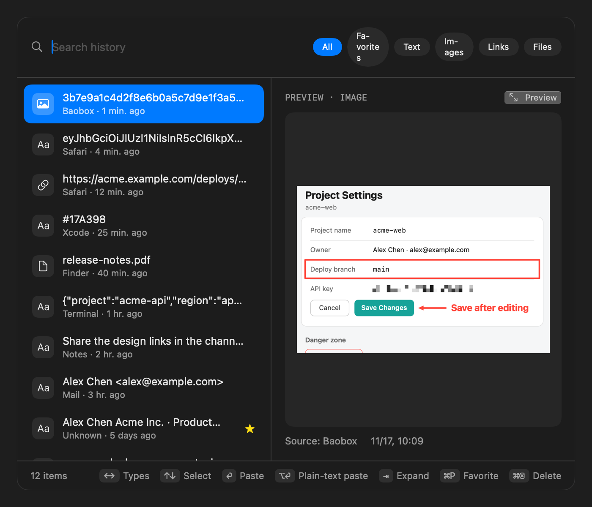
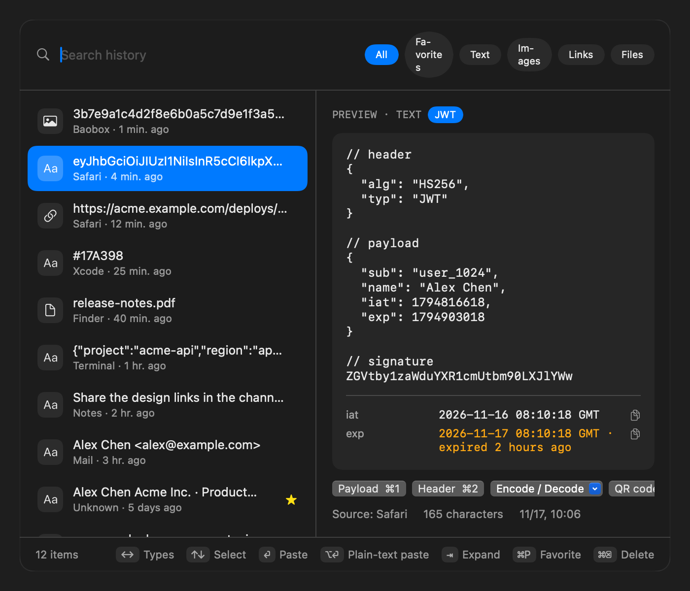
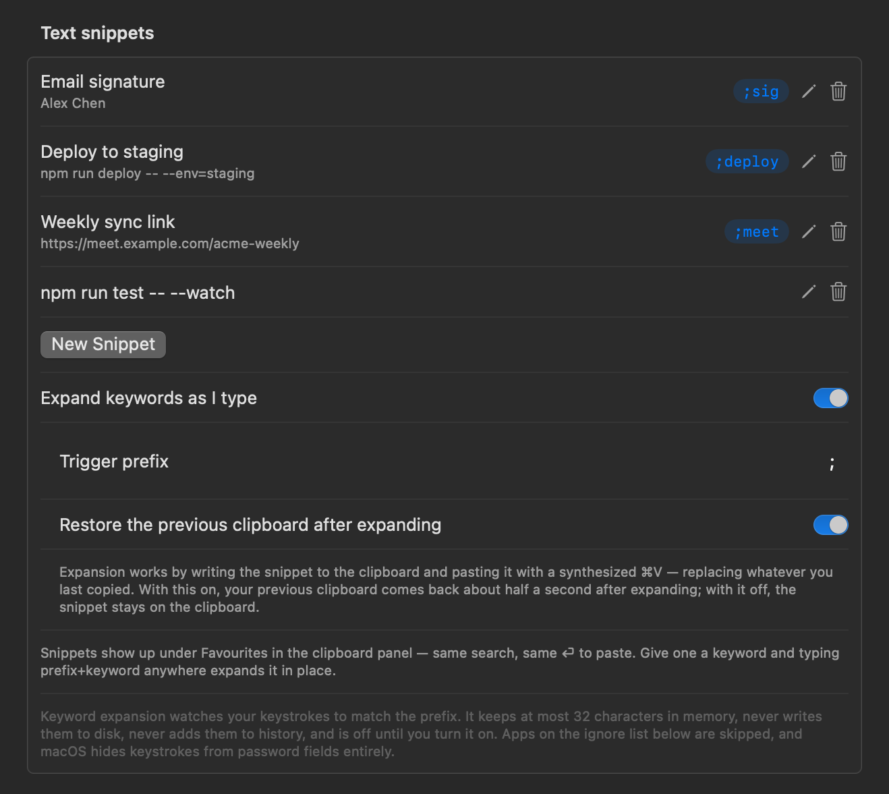

# Clipboard

[简体中文](../clipboard.md) · English

Menu bar → **Clipboard**. Default shortcut **⌘⇧V** opens the history panel.

Records text, images, files, and links, with search, paste-back, favorites, format
detection, and text snippets. Paste-back needs **Accessibility** permission (without it,
it degrades to copy-only).

## The history panel

**⌘⇧V** brings up a floating panel with the cursor already in the search field —
**type to filter**.

| Key | Action |
|---|---|
| Type | Filters history live |
| ↑ / ↓ | Move through results |
| ← / → | Switch the type filter (left to the cursor while the search field has text) |
| ⏎ | **Paste back** into the app you came from |
| ⌥⏎ | Paste as plain text |
| ⇥ | Expand the preview to the whole panel; press again to shrink it |
| ⌘P | Favorite / unfavorite |
| ⌘⌫ | Delete the selected entry |
| Esc | Close the panel (shrinks an expanded preview first) |

Type filters run across the top: **All / Favorites / Text / Images / Links / Files**.

The bottom row lists the common keys, with the total count on the left.

### Paste-back

Select an entry and press ⏎: Baobox writes it to the clipboard and simulates ⌘V into the
app **you were in a moment ago**.

Without Accessibility permission you're told once — "Copied, but auto-paste is off" — with a
button that takes you to the permission pane. The content is already on the clipboard, so
⌘V works manually.

If the source file behind an image entry has been cleaned up, you get "Can't paste this
entry" and a suggestion to delete the record.

### Plain-text paste

**⌘⌥V** pastes the most recent entry as plain text, dropping rich formatting. In the panel,
⌥⏎ does the same for the selected entry.

### Favorites

A favorited entry:

- Sits under the "Favorites" filter
- Is **never evicted** by the history size limit
- Is **never removed** by auto-cleanup
- **Survives "Clear history"**

[Text snippets](#text-snippets) are, mechanically, favorites you wrote yourself.

## Preview pane and text tools

Selecting an entry shows the full content, the source app, the character count and when it
was copied, in the preview pane on the right.

With "Detect content format in the preview pane" on, Baobox runs detection **only on the
selected entry** and offers matching conversions in place:

| Detected | Actions |
|---|---|
| JSON | "JSON" menu: format, minify, escape, unescape |
| JWT | Shown decoded right away as header / payload / signature, with iat / exp etc. as times and expired tokens labeled; actions: Payload, Header |
| XML / HTML | Format, minify |
| Timestamp | Seconds / millis / micros / nanos / Apple absolute time are told apart automatically, with local time, UTC, ISO 8601, and relative time |
| URL | "URL" menu: URL decode, URL encode, make a curl command |
| Base64 | Decode (encoding lives in "Encode / Decode" below) |
| curl command | "cURL" menu: expand to multiple lines, collapse to one, extract the URL; break out method, auth, body, form, and other flags |
| Any text | "Encode / Decode" menu (Base64 encode / decode, JWT decode, MD5, SHA1, SHA256), **QR code**, Pin, Edit (large editor) |

The first nine actions in the bar map to ⌘1…⌘9, in order.

Every action is an **in-place preview**; "Revert" (or ⌘0) returns to the original. Content beyond
the QR code capacity (2900 bytes) is reported rather than silently truncated.

**A second shortcut worth knowing**: "QR code from the most recent entry" (unbound by
default) pins a QR code of the latest text straight to the screen without opening the panel
— point a phone at it and it's gone.

### Large editor

When the preview is too small, click Edit in the action bar for a separate window: monospaced,
with undo and a ⌘F find bar. Click Copy when you're done.

### Pinned cards

Pin a piece of text above every window — the same idea as pinned screenshots, with text.
Copy or close it any time.

## Text snippets

Settings → Clipboard → Snippets. A snippet is **a favorite you wrote yourself**: it never
expires and "Clear history" never touches it. Snippets live among your other favorites in
the panel — same search field, same ⏎ to paste.

A new snippet has three fields: **name** (optional), **content**, and **keyword** (optional).

### Keyword expansion

Give a snippet a keyword, turn on "Expand keywords while typing", and typing
"prefix + keyword" (the prefix is configurable) in **any input field** expands it in place.

Requires Accessibility permission and is **off by default**.

The settings page is explicit about the privacy boundary: keyword expansion has to watch
keystrokes to match the prefix, so **at most 32 characters are held in memory, never written
to disk, and never added to history**; apps on the ignore list don't expand; and in password
fields macOS doesn't hand keystrokes to applications in the first place.

Expansion works by putting the snippet on the clipboard and simulating ⌘V, which displaces
whatever you had copied — hence a switch:

- **Restore the previous clipboard after expanding** (on by default) — restores it about
  half a second later
- Off leaves the snippet on the clipboard, convenient if you want to ⌘V it elsewhere

## Privacy

Settings → Clipboard → Privacy.

### Password manager content

Content marked `org.nspasteboard.ConcealedType` (passwords copied out of 1Password,
Bitwarden, Keychain Access) is **not recorded by default**. Leaving this off is recommended.

Turning it on asks for confirmation and states the tradeoff plainly: history is encrypted on
disk, but entries are shown **in plain text in the panel** — anyone who can use your
unlocked Mac can read them. Turning it back off **deletes every sensitive entry already
recorded**.

### Transient content

Content marked `org.nspasteboard.TransientType` is **always ignored**, with no switch — the
source app explicitly asked for it not to be saved.

### Ignored apps

Add an app to the ignore list and anything copied while it's frontmost isn't recorded.

## Storage and encryption

Settings → Clipboard → Storage.

- **History size limit** — the oldest **non-favorited** entries are evicted past the limit
- **Auto-cleanup** — 1 / 7 / 30 / 90 days, or never. Non-favorited entries older than that
  are removed; favorites always stay
- **Encrypt history at rest** (on by default) — text and images are encrypted with
  **AES-GCM** before being written to `~/Library/Application Support/Baobox/`. The key is a
  random 256-bit value in the **login keychain**; it never leaves this Mac and never syncs
  to iCloud

Toggling encryption converts existing history automatically. **Turning it off asks for
confirmation**, because existing history (images included) gets rewritten to disk in
plaintext, readable by anything with access to your user account.

If the keychain is unavailable (login keychain locked) you're told history is temporarily
written in plaintext; unlock it and restart Baobox.

## Clearing history

"Clear history…" on the settings page asks for confirmation. **Favorites are kept.**
