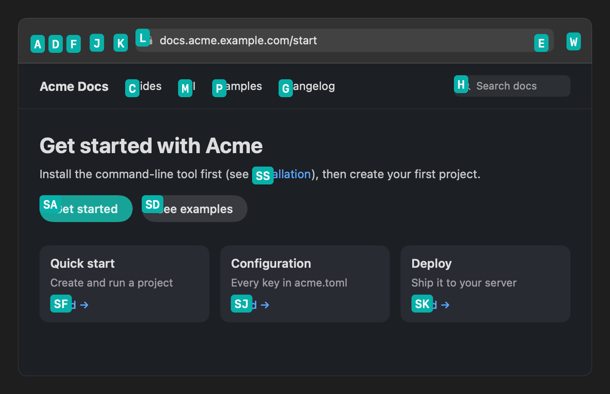
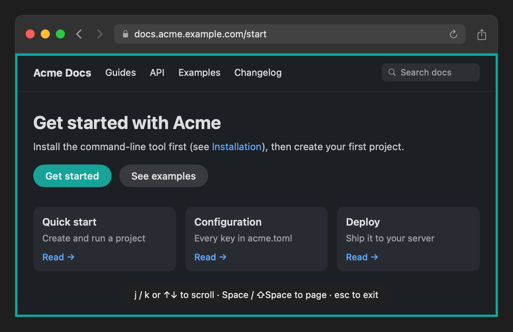

# Keyboard clicking

[简体中文](../keyboard-nav.md) · English

Menu bar → **Keyboard Click**. Default shortcut **⌘⇧Space**.

Press it and every **clickable element** on screen gets a letter label (a single letter when there
are few elements, two or more when there are many); type the label's letters to click it. Your hands
never leave the keyboard.

Requires **Accessibility** permission. Without it the menu says so.

## How to use it

1. Press **⌘⇧Space**
2. Letter labels appear
3. Type a label's letters → that element is clicked
4. **Esc** cancels

Labels come from scanning the accessibility tree, so they mark **real controls** (buttons,
links, menu items, checkboxes…) rather than guesses from pixels — moving a window or
changing resolution doesn't affect accuracy.

Clicks prefer the system's `AXPress` action, which **doesn't move your real mouse**. Only
when an element doesn't support `AXPress` does it fall back to synthesizing a click at the
element's center.

## Continuous mode

Settings → Keyboard Click → Continuous clicking:

- **On** — labels refresh automatically after each click so you can keep going.
  **Esc or a real mouse click** exits
- **Off** — one click per shortcut press

Worth having on when you need to hit several things in a row, like ticking a column of
checkboxes.

## Label scope

Settings → Keyboard Click → Label display range: **Current screen only** or **All screens**.

On a multi-display setup, "Current screen only" means fewer labels and less hunting.

## Keyboard scrolling

The second action: **Scroll** (unbound by default; menu → Keyboard Click → Scroll).

It exists for pages that **don't take focus and don't expose a scrollbar element** — Chrome
being the classic case, where ordinary keyboard clicking can't reach the scroll area.

In scroll mode:

| Key | Action |
|---|---|
| j / ↓ | Scroll down |
| k / ↑ | Scroll up |
| Space | Page down |
| ⇧Space | Page up |
| Esc | Exit |

That hint line is shown on screen, so there's nothing to memorize.

